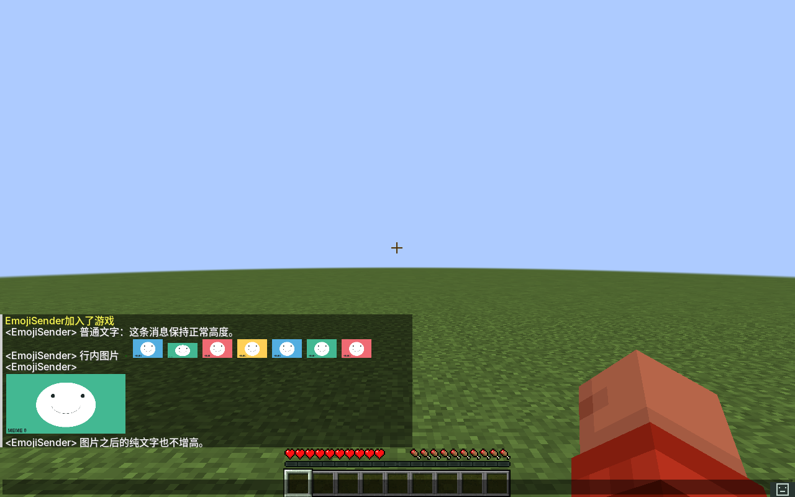
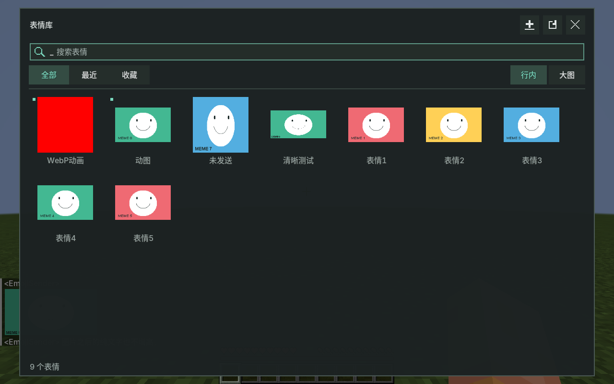
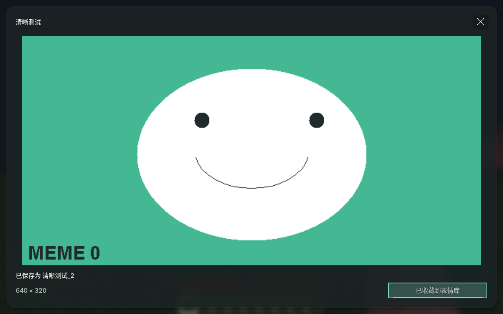
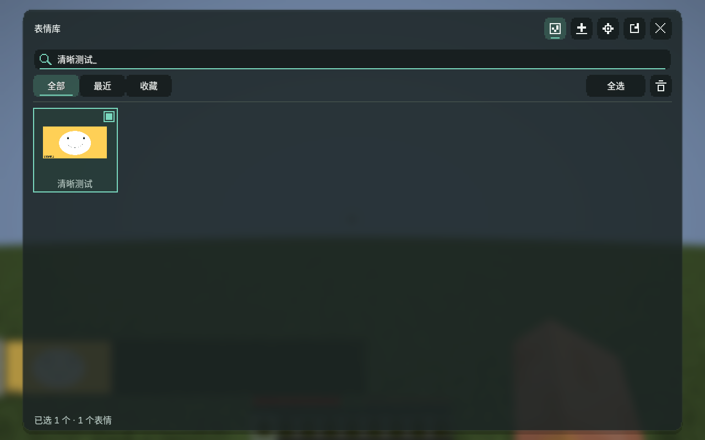
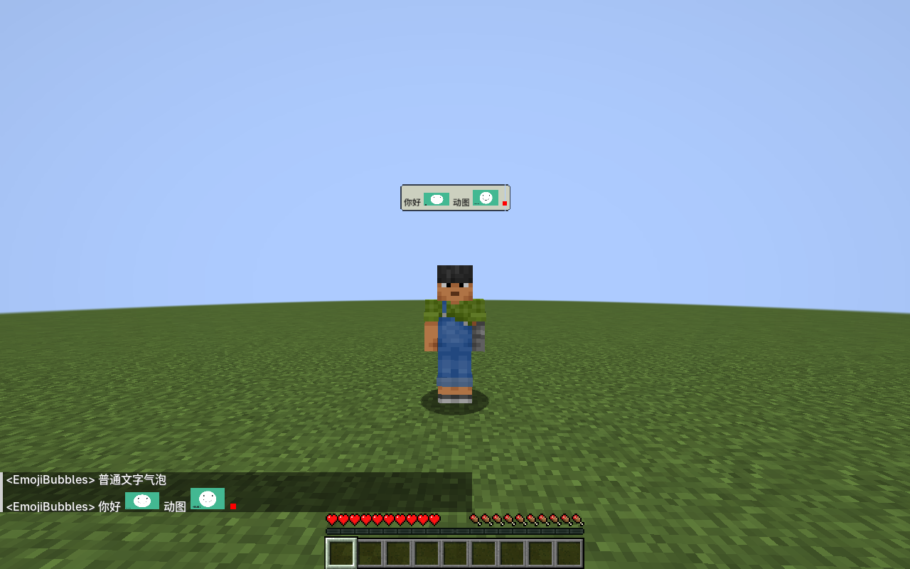
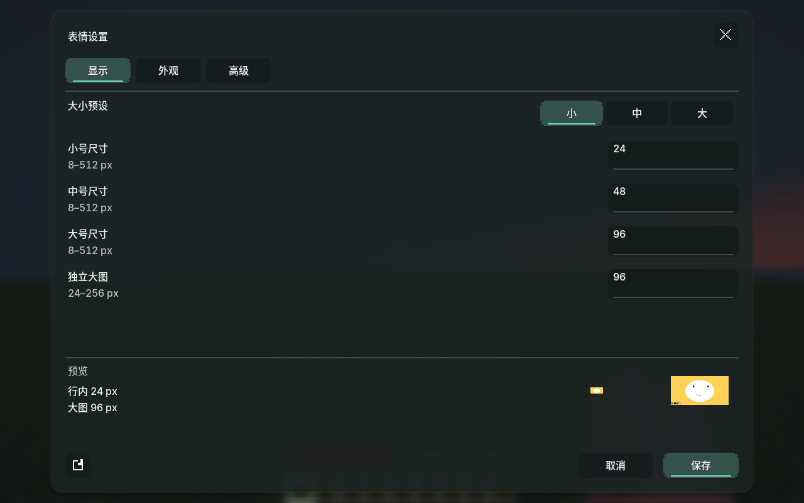

# MemeEmoji

把自己的表情包带进 Minecraft。

MemeEmoji 是适用于 **Minecraft 1.21.1 · Fabric** 的个人表情包模组。文字里夹一张小表情，或单独发一张大图；GIF 和动态 WebP 也能直接播放。每个人管理自己的图库，发送时才通过服务器按需传图。看到喜欢的图片，直接收藏成自己的表情包。



## 能做什么

| 功能 | 游戏中的体验 |
|---|---|
| 行内表情与独立大图 | 小表情跟着文字走，大图单独占行；纯文字保持原版行高 |
| 动图播放 | GIF、动态 WebP 在聊天、表情面板和图片预览中播放 |
| 个人表情库 | 搜索、收藏、最近使用，支持文件选择导入与拖拽导入 |
| 管理与删除 | 多选、跨搜索选择、批量永久删除，已发送图片保留显示 |
| 收藏朋友的表情 | 右键聊天图片快速收藏，或在大图预览中收藏；保留原文件和动画 |
| 毛玻璃界面 | 表情库、预览和设置统一半透明设计，背景真实模糊，支持深浅主题和自定义颜色 |
| 游戏内设置 | 大小预设、尺寸和外观即时预览，点击保存生效，取消不改变原设置 |
| 高清预览 | 显示尺寸与源图像素分开，按比例显示、不裁切，点击聊天图片放大查看 |
| 按需联机传图 | 只传当前消息用到的图片，不在加入服务器时同步整套图库 |
| 模组兼容 | 可与 ModernUI 共用，也支持 TalkBubbles 头顶气泡 |

## 安装

| 环境 | 要求 |
|---|---|
| 游戏 | Minecraft 1.21.1 |
| 加载器 | Fabric Loader 0.16.0 或更新版本 |
| Java | Java 21 |
| 必装模组 | MemeEmoji、Fabric API，服务器和每位玩家都需要安装 |
| 可选模组 | ModernUI；TalkBubbles 的安装见下方说明 |

从 [GitHub Releases](https://github.com/HuaJiY/MemeEmoji/releases/latest) 下载模组 jar，放进对应游戏端与服务器的 `mods` 文件夹。也支持单人游戏。

## 发出第一张表情

1. 打开聊天框，点击右侧表情按钮，或按 `Ctrl+E`。
2. 点击面板右上角的导入按钮选择图片，也可以把图片文件直接拖进面板。
3. 选择“行内”或“大图”，点击想发的表情。
4. 返回聊天框后按回车发送，可以先补上文字再发送。



表情库中的星标或右键用于切换收藏。点击聊天里的图片可放大查看，按 `ESC` 返回时保留聊天草稿和光标位置。

也可以把图片放进 `config/memeemoji/emoji/`，用 `:文件名:` 发送。例如文件 `开心.gif` 对应：

```text
今天心情不错 :开心:
```

支持 **PNG、JPG、JPEG、GIF、WebP、BMP**。表情名称取不含扩展名的文件名，不区分大小写，不能包含空格或冒号。同名导入会自动添加后缀；手动放入的重名文件会在面板底部提示。

表情文件与配置修改后约 500ms 自动刷新，无需重启游戏。也可以点击面板刷新按钮，或执行 `/memeemoji reload`。

## 收藏别人的表情

打开聊天框，右键想收藏的图片；也可以左键打开预览，再点击“收藏到表情库”。图片会下载并另存进自己的 `emoji/` 文件夹，同时加入“收藏”。原始像素和 GIF、WebP 动画都会保留，同名自动添加后缀，重复收藏不会生成多份副本。

收藏后即可从自己的图库发送，原发送者离线也不影响使用。删除收藏副本后，再收藏会重新保存。



## 删除自己的表情

点击表情库右上角的管理按钮，勾选图片，再点击垃圾桶。可以单张删除，也可以用“全选”批量删除当前搜索结果；更换搜索词不会清除已选图片。确认页点击“永久删除”后，个人库原文件会被永久删除，同时清理收藏与最近使用，无法撤销。点击“取消”不改动文件。

删除前会将原始图片留在聊天缓存中，因此已经发送的图片仍能显示，GIF 和 WebP 动画也会保留；删除个人库文件不等于清除聊天缓存。仍可从聊天图片重新收藏。



## TalkBubbles 头顶气泡

可选支持 Minecraft 1.21.1 的 [TalkBubbles 1.0.8](https://modrinth.com/mod/talk-bubbles/version/MEHKQGEi)。需要显示头顶气泡的客户端安装 TalkBubbles 及其依赖 Cloth Config，服务器无需安装这两个模组。

发送方式不变，行内表情、独立大图、GIF 和动态 WebP 都会显示在发送者头顶。图片气泡按实际内容计算大小，普通文字仍使用 TalkBubbles 原有实现；距离、显示时长、缩放、背景颜色和是否显示自己的气泡仍由 TalkBubbles 配置控制。可以与 ModernUI 同时使用。



## 图片如何传给其他玩家

个人表情库由自己管理。接收的图片只进缓存，主动收藏后才保存进自己的图库。图片经过以下路径共享：

```text
发送者的本地图片 → 服务器缓存 → 需要显示这张图片的玩家
```

发送消息时，客户端只上传本条消息引用且服务器尚未缓存的图片。其他玩家收到图片信息后，在图片需要显示时向服务器请求文件，并缓存到本地。

不会在加入服务器时上传或下发整套表情库。同名图片通过 UUID 区分，不会替换其他玩家的图片。修改本地图片后会获得新 UUID，未修改的图片保持标识和缓存。

上传和下载按连接轮转分批发送，每个游戏刻最多发送 4 个 24 KiB 分片，避免一次塞入整个文件。排队下载不消耗传输超时；开始处理后，连续 45 秒没有进度才判定超时。服务器复用最近使用的原文件内存缓存，上限为 32 MiB、64 个文件，不改变图片质量。

聊天显示尺寸与源文件像素独立：不会为了显示成小表情而把文件压缩成低分辨率图片。图片按比例显示，不裁切；预览可使用保留下来的完整像素。

| 限制 | 数值 |
|---|---|
| 单文件 | 8 MB |
| 宽、高 | 各不超过 2048 像素 |
| 动图 | 最多 1000 帧，所有完整画布帧合计不超过 16,777,216 像素 |
| 每条消息 | 最多 16 张不同图片，文字和内部图片标记合计 2048 字符 |

超限或无法读取的图片会在面板中提示原因。

## 配置与文件

点击表情库右上角的齿轮，或输入 `/memeemoji config` 打开设置。设置分为“显示、外观、高级”，修改时立即预览；点击“保存”才应用并写入文件，点击“取消”或按 `ESC` 放弃改动。“恢复默认”也只修改当前草稿，仍需保存。



所有选项也可在 `config/memeemoji/config.json` 中修改。图片显示尺寸单位为游戏界面像素，最终屏幕大小还受 GUI 和聊天缩放影响。背景模糊直接使用 Minecraft 自带效果，不要求安装 ModernUI。

| 字段 | 默认值 | 用途 |
|---|---|---|
| `enabled` | `true` | 启用表情功能 |
| `maxNameLength` | `32` | 本地名称长度上限，最大 128 |
| `sizePreset` | `"small"` | 行内尺寸预设：`small` / `medium` / `large` |
| `smallCellSize` | `24` | 小号最长边 |
| `mediumCellSize` | `48` | 中号最长边 |
| `largeCellSize` | `96` | 大号最长边 |
| `maxCellSize` | `128` | 行内最长边上限 |
| `stickerSize` | `96` | 独立大图最长边，范围 24–256 |
| `uiTheme` | `"dark"` | 深浅主题：`dark` / `light` |
| `blurRadius` | `7` | 背景模糊强度，0–10；0 为关闭 |
| `panelOpacity` | `190` | 面板不透明度，64–255 |
| `accentColor` | `"#7AD8BE"` | 强调色，格式 `#RRGGBB` |
| `darkSurfaceColor` | `"#192222"` | 深色主题面板颜色 |
| `lightSurfaceColor` | `"#F1F5F3"` | 浅色主题面板颜色 |

| 路径 | 内容 |
|---|---|
| `config/memeemoji/emoji/` | 自己的原始图片，可使用子目录 |
| `config/memeemoji/library-index.json` | 文件与 UUID 的索引、已收藏图片的副本关联 |
| `config/memeemoji/library-ui.json` | 收藏和最近使用 |
| `config/memeemoji/received/` | 接收图片及删除前保留的聊天缓存，不加入个人表情库 |
| `<世界目录>/memeemoji/assets/` | 此世界的服务器图片缓存 |

## 构建与检查

```powershell
.\gradlew.bat build
```

产物：`build/libs/memeemoji-0.4.0.jar`。`build` 包含图片解码、真实目录监听、聊天几何、协议分片及传输队列检查。

游戏检查使用独立的 `src/qa` 模组，不打包进正式 jar。三个终端依次启动服务器、接收方、发送方：

```powershell
.\gradlew.bat runQaServer
.\gradlew.bat runQaReceiver
.\gradlew.bat runQaSender
```

检查使用 `build/qa-*` 隔离目录，本地服务器仅绑定 `127.0.0.1:25579`，生成专用世界，不使用现有存档。开发客户端可从 `run/mods` 复制 ModernUI 与 ForgeConfigAPIPort，也可通过 `-PqaModsDir=<目录>` 指定。结果和实机截图位于 `build/qa-evidence`，以 `sender-result.txt`、`receiver-result.txt` 中的 `PASS` / `FAIL` 为准，客户端正常退出不代表检查通过。检查完成后在服务器终端输入 `stop`。再次完整运行前清理这些专用 QA 目录。

检查 TalkBubbles 时，在 QA 服务器运行期间执行 `./gradlew.bat runQaBubbles -PwithTalkBubbles`。此参数仅向开发客户端添加 TalkBubbles 和 Cloth Config，不打包进正式产物。检查文字、行内图片、大图、再次发送文字、隐藏自己的气泡和到期消失，结果为 `build/qa-evidence/talkbubbles-result.txt`。

完整双客户端检查后，可保留专用服务器缓存，用 `./gradlew.bat runQaSender -PqaFocus=settings` 单独检查设置草稿、保存、取消、深浅主题、真实模糊、小窗口滚动、排队下载及离线缓存收藏。`./gradlew.bat runQaVanilla` 在不安装 ModernUI 的独立目录执行同一检查。服务器需保持运行，结果分别为 `sender-focus-result.txt` 和 `vanilla-focus-result.txt`。

删除流程用 `./gradlew.bat runQaSender -PqaFocus=maintenance` 和 `./gradlew.bat runQaVanilla -PqaFocus=maintenance` 检查：实际点击管理、取消、单张与批量永久删除、偏好清理、重载、历史图片缓存和重新收藏。服务器需保持运行，结果为 `sender-maintenance-result.txt`、`vanilla-maintenance-result.txt`，截图使用 `modernui-` / `vanilla-` 前缀。

## 实现与参考

- 图片使用独立动态纹理；文字仍调用 Minecraft 字体接口，兼容 ModernUI，不再生成资源包或占用私用区字体码位。
- GIF 使用 Java ImageIO；WebP 使用 TwelveMonkeys 3.12.0 纯 Java 解码器，并实现动画帧时长、混合、清除及其缺失的原始透明通道处理，避免额外原生运行库。
- 参考 [Exposure 1.21.1](https://github.com/mortuusars/Exposure/tree/1.21.1) 的上传、服务器存储、客户端按需请求结构；MemeEmoji 保留完整颜色和原始图片文件，不使用 Exposure 的调色板压缩。
- [ModernUI](https://github.com/BloCamLimb/ModernUI-MC)、[TwelveMonkeys](https://github.com/haraldk/TwelveMonkeys)。
